<p align="center">
  
</p>

<h1 align="center">ArrMada</h1>

<p align="center">
  <strong>Ta médiathèque de films et séries, à la maison, sans prise de tête.</strong><br/>
  Tu demandes un titre, ArrMada le trouve, le télécharge, le range et l'affiche sur ta TV.
</p>

<p align="center">
  <a href="https://tcastel94.github.io/arrmada/installation/"></a>
  <a href="#-captures-décran"></a>
  <a href="#-pour-les-curieux-et-les-développeurs"></a>
</p>

<p align="center">
  
  
  
</p>

---

## 🎯 C'est quoi ?

Pour avoir des films et des séries « comme sur Netflix » chez soi, il faut d'habitude
**installer et relier six ou sept logiciels** (Sonarr, Radarr, Prowlarr, Bazarr, un logiciel de
téléchargement, Jellyfin…), recopier des clés entre eux et passer d'un onglet à l'autre.

**ArrMada fait ce travail à ta place :**

| Avant | Avec ArrMada |
|-------|--------------|
| 7 logiciels à installer un par un | **Une commande** installe tout, adapté à ta machine |
| Des clés API à recopier partout | **« Tout connecter »** : un bouton relie les applis entre elles |
| Des réglages qu'on oublie | Une liste **« Ce qu'il te reste à faire »**, vérifiée en direct |
| 7 onglets ouverts | **Une seule appli**, sur ordinateur, téléphone, tablette et TV |
| Des menus pour du matériel qu'on n'a pas | **Tu dis ce que tu as** (TV, tablette, ampli, caméras) : le reste disparaît |

> 👵 **Pensé pour tout le monde.** L'installation est guidée de bout en bout : chaque étape dit
> quoi faire, pourquoi, et quoi faire si ça ne marche pas. Pas besoin d'être informaticien.

---

## 🚀 Installer

### Le plus simple : le guide pas à pas

👉 **[tcastel94.github.io/arrmada/installation](https://tcastel94.github.io/arrmada/installation/)**

Tu choisis ton appareil (**Synology**, Unraid, PC Windows, Mac, serveur Linux), tu réponds à
deux questions, et le guide te donne les étapes exactes avec des cases à cocher, des boutons
« Copier » et une aide à chaque étape.

> **Synology : aucune ligne de commande.** Tout se fait dans l'interface de DSM, avec une tâche du
> *Planificateur de tâches* qu'on lance une seule fois.

### Pour ceux qui connaissent le terminal

Installe **toute la pile** (Sonarr, Radarr, Prowlarr, Bazarr, SABnzbd, Deluge ou qBittorrent,
Jellyfin et ArrMada), avec les dossiers [TRaSH Guides](https://trash-guides.info/) et des clés
API pré-générées :

```bash
curl -fsSL https://raw.githubusercontent.com/tcastel94/arrmada/main/install.sh | sudo bash
```

Options utiles : `--yes` (aucune question), `--torrent deluge|qbittorrent`, `--no-usenet`,
`--no-jellyfin`, `--config-root` / `--data-root`. Détails : [docs/installer.md](docs/installer.md).
Sur **Synology**, lis d'abord sa [section dédiée](docs/installer.md#synology-dsm-72) : dossier
partagé `data` créé dans DSM avant tout, PUID/PGID, réseau Compose, hairpin, sources Kodi.

Tu as **déjà** tes applis ? Installe ArrMada seul :

```bash
mkdir -p /opt/arrmada && cd /opt/arrmada
curl -fsSLO https://raw.githubusercontent.com/tcastel94/arrmada/main/docker-compose.yml
docker compose up -d
```

### Ensuite : l'assistant intégré

Ouvre **`http://<adresse-de-ta-machine>:3420`**. L'assistant t'accompagne jusqu'au premier film :

| Étape | Ce qui se passe |
|-------|-----------------|
| 1. Bienvenue | Le plan de route, rien à faire |
| 2. Mot de passe | Tu choisis le mot de passe d'ArrMada (pas de fichier à modifier) |
| 3. Applications | **« Tout connecter »** : ArrMada lit les clés de tes applis et les relie (chaque branchement est testé) |
| 4. À faire | Ce qu'aucun installeur ne peut faire à ta place (ajouter des sources dans Prowlarr, ton fournisseur Usenet…), **vérifié en direct** dans chaque appli, avec un lien direct et les mots de passe générés |
| 5. Équipement | TV, tablette, ampli, caméras : **tout est facultatif**, « je n'en ai pas » par défaut |
| 6. Terminé | Récapitulatif et prochaines étapes |

| Besoin | Commande |
|--------|----------|
| Mettre à jour | `docker compose pull && docker compose up -d` |
| Voir les journaux | `docker logs -f arrmada` |
| Mot de passe oublié | `docker exec -it arrmada arrmada-cli set-password` |
| Sauvegarder | copier le dossier `./data` |

---

## 📸 Captures d'écran

### L'assistant d'installation

<p align="center">
  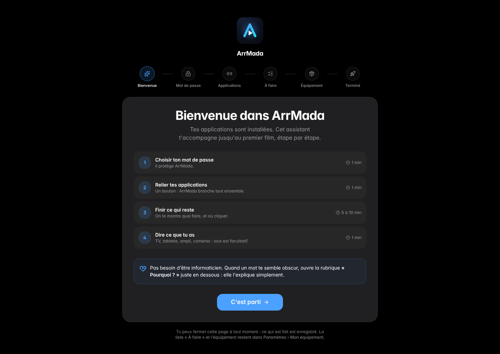
  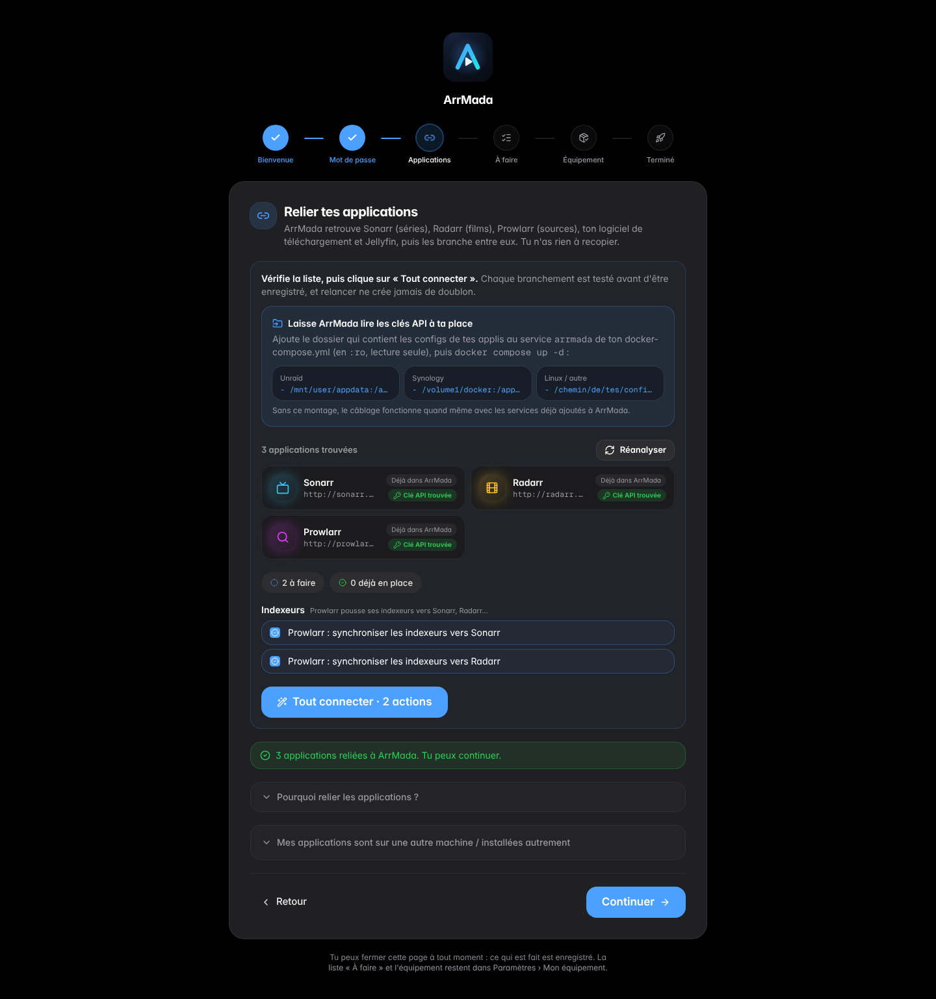
</p>
<p align="center">
  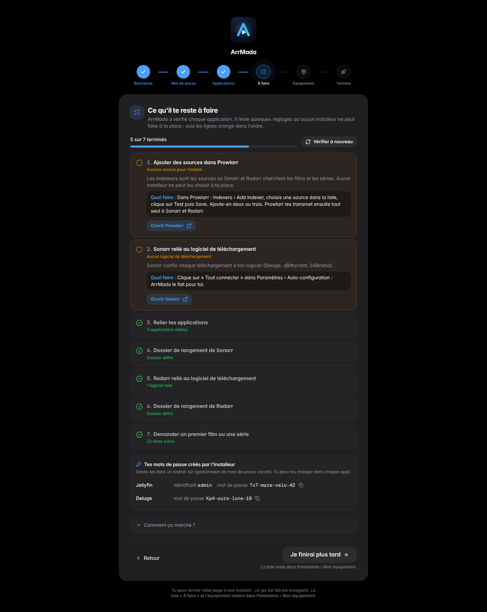
  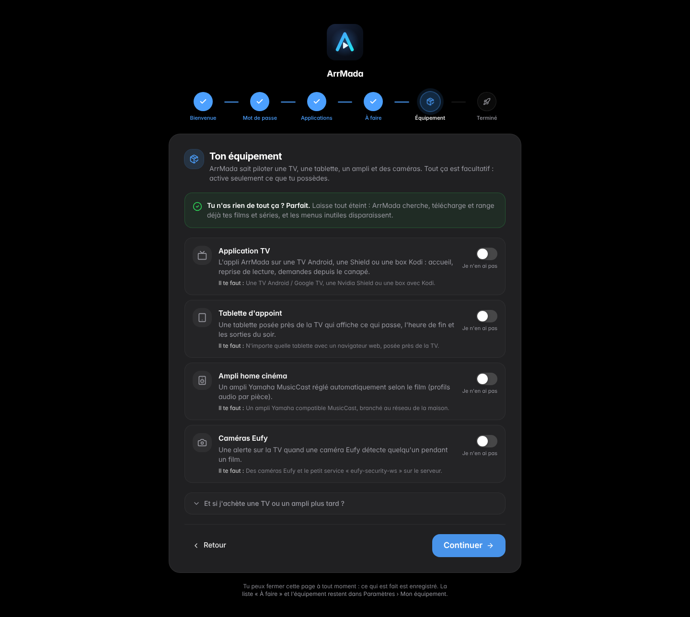
</p>
<p align="center"><em>Bienvenue · « Tout connecter » · la liste vérifiée de ce qu'il reste à faire · l'équipement facultatif</em></p>

### L'appli web (ordinateur)

<p align="center">
  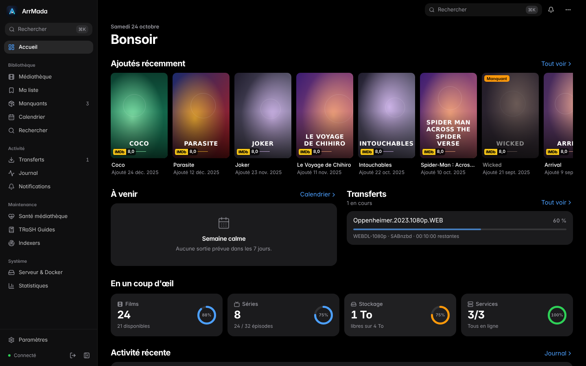
  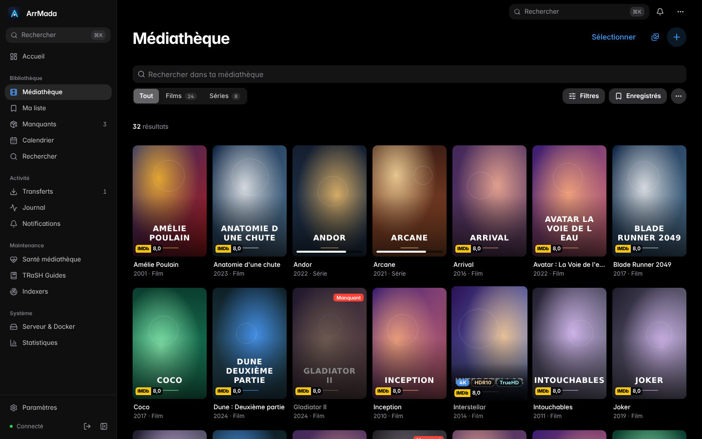
</p>
<p align="center">
  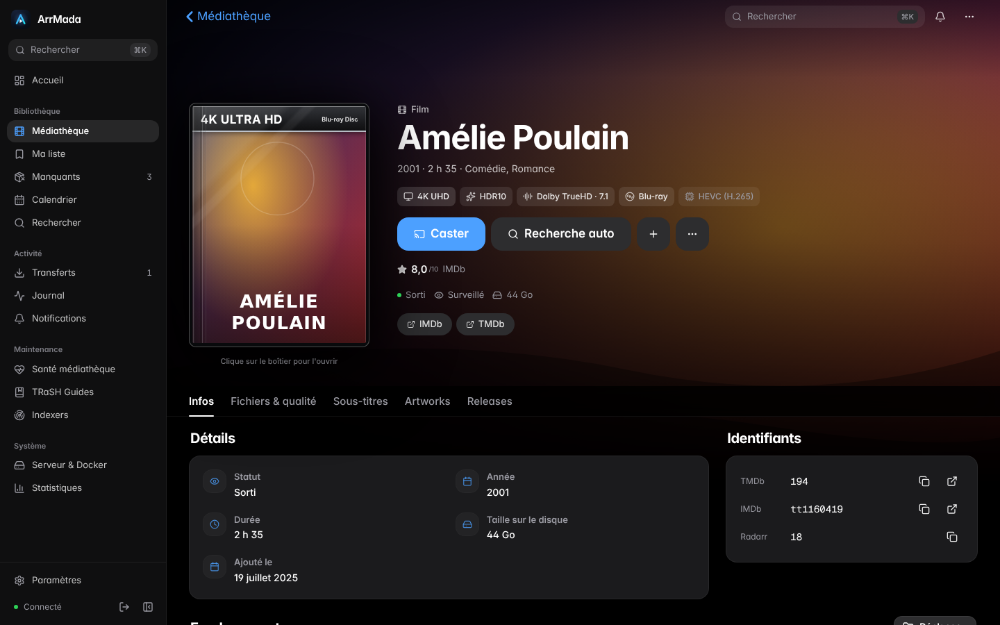
  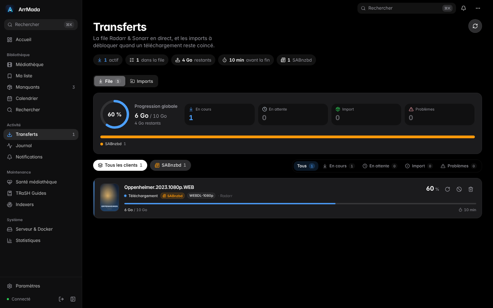
</p>
<p align="center">
  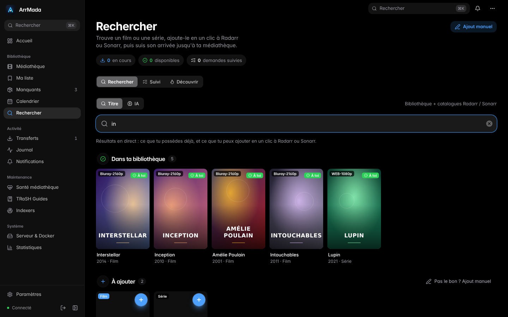
  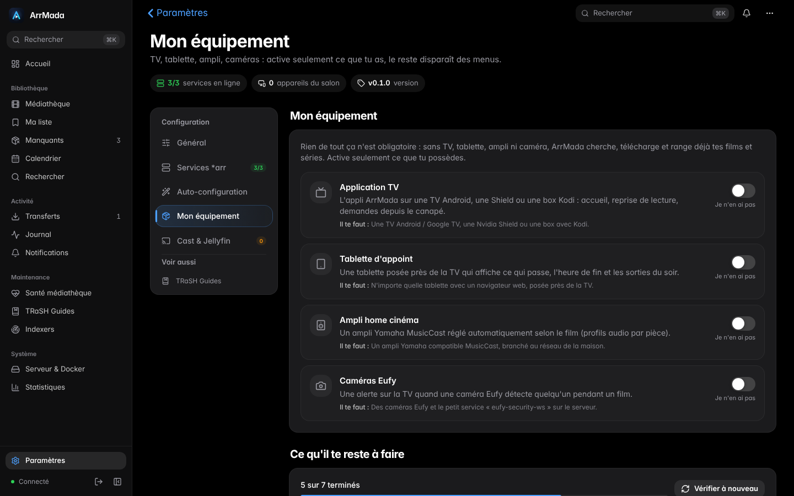
</p>
<p align="center"><em>Accueil · Médiathèque · Fiche d'un film · Transferts · Rechercher & ajouter · Mon équipement</em></p>

### Sur le téléphone

<p align="center">
  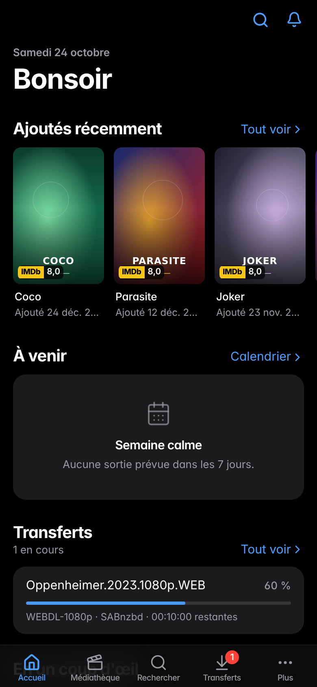
  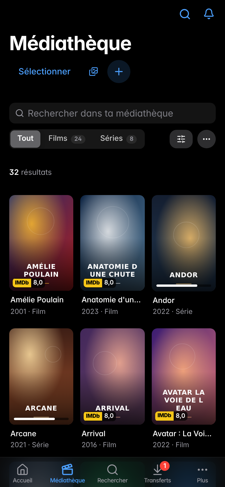
  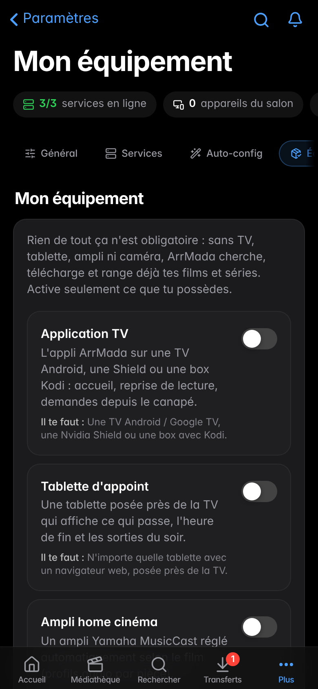
  
</p>

### La tablette près de la TV *(facultatif)*

<p align="center">
  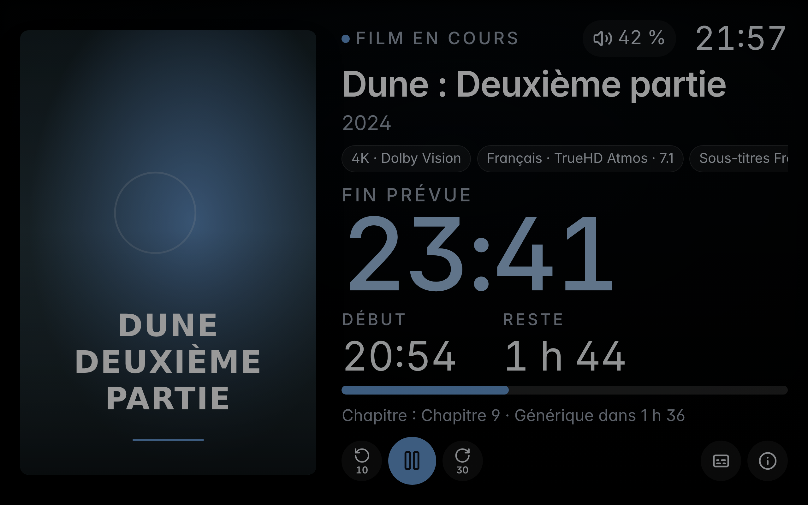
  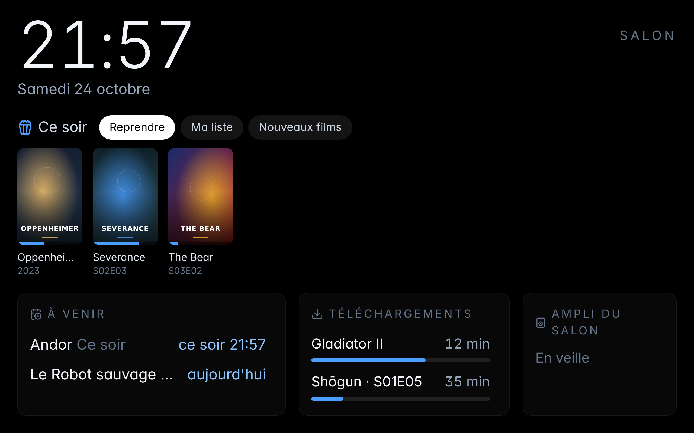
</p>
<p align="center"><em>Pendant un film : heure de fin, pistes, ampli, téléchargements · Le reste du temps : quoi regarder ce soir</em></p>

### L'appli TV *(facultatif)*

<p align="center">
  
  
</p>
<p align="center">
  
  
</p>
<p align="center"><em>Captures générées automatiquement par la CI Android à chaque mise à jour (affiches factices).</em></p>

> Toutes les affiches des captures sont **factices** (générées) : aucune image protégée dans le dépôt.

---

## ✨ Ce que fait ArrMada

### Pour tout le monde
- **Rechercher & ajouter** un film ou une série, suivre les demandes, suggestions « Pour toi ».
- **Médiathèque** unifiée (films + séries), filtres, fiches détaillées (distribution, fichiers,
  qualité, sous-titres, bande-annonce).
- **Transferts** en direct (SABnzbd, Deluge, qBittorrent) avec réessai, liste noire, import manuel.
- **Calendrier** des sorties, **Manquants**, **Notifications** en temps réel.
- **Santé de la médiathèque** : qualité, doublons, nettoyage, profils [TRaSH Guides](https://trash-guides.info/).
- **Serveur & Docker** : disques, ressources, journaux de chaque conteneur et diagnostic par IA
  (Ollama local ou OpenRouter, facultatif).
- **Palette de commandes** `⌘K` / `Ctrl+K` et raccourcis clavier (`?` pour la liste).

### Selon ton équipement *(Paramètres › Mon équipement)*

| Module | Il te faut | Ce que ça ajoute |
|--------|------------|------------------|
| 📺 **Application TV** | TV Android / Google TV, Nvidia Shield ou box Kodi | Appli TV native ([android/](android/README.md)) ou add-on Kodi ([kodi-addon/](kodi-addon/README.md)) : accueil, reprise de lecture partagée, demandes depuis le canapé, page **Reprendre**, profils famille |
| 📱 **Tablette d'appoint** | N'importe quelle tablette avec un navigateur | Page `/ecran` : ce qui passe, heure de fin, pistes, sorties du soir ; assombrie pendant le film |
| 🔊 **Ampli home cinéma** | Ampli Yamaha MusicCast | Profils audio par pièce appliqués au lancement d'un film, télécommande dans **Salon** |
| 📷 **Caméras Eufy** | Caméras Eufy + pont `eufy-security-ws` | Alerte sur la TV quand quelqu'un est détecté pendant un film |

Un module **désactivé disparaît** des menus, des réglages et n'interroge plus rien en tâche de
fond. Une instance existante garde ce qu'elle utilise déjà (TV appairée, ampli enregistré…) :
c'est détecté automatiquement.

---

## 🔒 Sécurité

| Couche | Mise en œuvre |
|--------|---------------|
| Mot de passe | Créé dans l'assistant, stocké haché (scrypt), aucun mot de passe par défaut |
| Session | JWT avec secret aléatoire propre à chaque instance |
| Clés API | Chiffrées au repos (Fernet) ; elles ne transitent jamais par le navigateur |
| Connexion | Limitation des tentatives (anti force brute) |
| En-têtes | HSTS, CSP, X-Frame-Options, Permissions-Policy |
| Conteneur | Utilisateur non-root, API sur la même origine (CORS fermé) |
| Appareils | TV et tablettes appairées par code, jeton propre révocable à tout moment |

Détails : [ADR-002](docs/adr/002-security-architecture.md).

---

## 🛠️ Pour les curieux et les développeurs

### Architecture

```
┌───────────────────── conteneur arrmada ──────────────────────┐
│  :3420  gateway.js ──┬── /api/*  ──► FastAPI   127.0.0.1:8420 │
│                      ├── /kodi/* ──► FastAPI (dépôt Kodi)     │
│                      └── reste   ──► Next.js   127.0.0.1:3421 │
│  /app/data : base · clé Fernet · secret JWT · hash admin      │
└──────────────────────────────────────────────────────────────┘
```

Un seul port (3420). Le port historique 8420 reste publié pour les TV Kodi déjà configurées.
Base **SQLite** par défaut (dossier `./data` sur un disque local, jamais sur un partage NFS/SMB),
**PostgreSQL** en option :

```bash
echo "POSTGRES_PASSWORD=$(openssl rand -hex 24)" >> .env
docker compose -f docker-compose.yml -f docker-compose.postgres.yml up -d
```

### Applications prises en charge

| Appli | Rôle | Port | Intégration |
|-------|------|:----:|-------------|
| Sonarr | Séries | 8989 | Complète (médiathèque, recherche, import) |
| Radarr | Films | 7878 | Complète (médiathèque, recherche, import) |
| Prowlarr | Sources (indexeurs) | 9696 | Synchro vers Sonarr / Radarr, statistiques |
| Bazarr | Sous-titres | 6767 | Téléchargement, resynchro |
| SABnzbd | Téléchargement Usenet | 8080 | File d'attente, configuration TRaSH |
| Deluge / qBittorrent | Téléchargement torrent | 8112 / 8080 | File d'attente |
| Jellyfin | Lecture | 8096 | Lecture, transcodage pour Chromecast |
| Lidarr / Readarr | Musique / livres | 8686 / 8787 | Surveillance |

### Développement

```bash
# Backend (FastAPI)
cd backend && python -m venv .venv && . .venv/bin/activate
pip install -r requirements.txt
uvicorn app.main:app --reload --port 8000
python -m pytest -q          # tests
ruff check . && ruff format . # style

# Frontend (Next.js) — /api est relayé vers :8000 en dev
cd frontend && npm install && npm run dev

# Image Docker
docker build -t ghcr.io/tcastel94/arrmada:latest .
```

### Documentation

| Document | Contenu |
|----------|---------|
| [Guide d'installation](https://tcastel94.github.io/arrmada/installation/) | Pas à pas par appareil, pour les non-techniciens |
| [docs/installer.md](docs/installer.md) | `install.sh` : options, chemins par plateforme |
| [docs/deploy-unraid.md](docs/deploy-unraid.md) | Migration de l'ancien déploiement Unraid |
| [android/README.md](android/README.md) | Appli TV / téléphone / tablette |
| [kodi-addon/README.md](kodi-addon/README.md) | Add-on Kodi |
| [CHANGELOG](CHANGELOG.md) | Historique des versions |
| [docs/adr/](docs/adr/) | Décisions d'architecture |

---

## 🤝 Contribuer

Les contributions sont bienvenues : crée une branche, fais tes changements, ouvre une Pull Request.
Lis le [CHANGELOG](CHANGELOG.md) pour connaître l'état actuel du projet.

## 📜 Licence

MIT — voir [LICENSE](LICENSE).

<p align="center">Fait avec ☠️ par l'équipage d'ArrMada</p>
